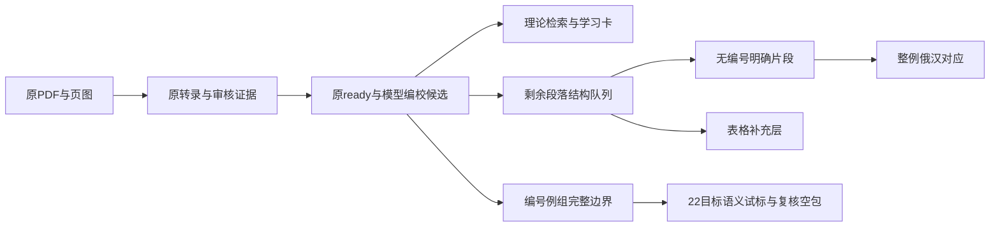

# 《现代俄语体学》当前研究使用说明

本书知识库可用于论文的理论依据检索、页级引文追踪、编校证据讨论及标注规范开发。当前材料属于教材研究资源；独立自然语料、专家盲评及生成对照尚未完成。

论文写作可从[方法与工程结果底稿](aspect_reference_thesis_methods_20261024.md)进入，42项统计记录有报告指纹及字段定位。另附[57译对待独立复核包](../data/processed/aspect_reference/research_exports/aspect_translation_review_20261024_001/README.md)，晚于ZIP002封存，单独交付。

[八题证据充分性分析](aspect_reference_evidence_sufficiency_20261024.md)补充主题相关与回答事实之间的区别；含5条明确标记的本地合成反例，未调用生成服务或改变默认算法。

[论文附件与统一例证查询](aspect_reference_thesis_supplement_20261024.md)提供轻量ZIP下载、字面AND及俄文词形边界查找。查询结果按教材例组计量，不能直接当自然语料频次。

当前推荐[行内041及26日主交付003](aspect_reference_inline_extension_20261026_041.md)：目录20261026_003，330文件/50隔离验收、字节复建通过。总2176来源组、默认509/显式2059；行内723组/435对应、46纯汉语。行内空表2610格、编号空表8010格均空；独立评价0。54段旧词项队列已逐段记录处置，行内仍未穷尽。

## 当前范围

| 材料 | 已完成范围 | 使用限制 |
|---|---|---|
| 原转录 | 471来源页，100理论及60非理论单元 | 原印40 ready、60 unresolved；原库保留 |
| 编校候选002 | 40原ready＋53模型候选，7隔离；128编辑 | 默认40节，显式候选93节；候选不等于专家审定 |
| 编号范围044 | 原1453锚段全分类；1452有效＋1分析排除，另1异常编号补定位，得到1453例组 | 默认269、显式1336、隔离117；21例扩段，不是句数或词次 |
| 无编号补充041 | 723组、184来源页 | 240原ready/483候选；46纯汉语，行内未穷尽 |
| 余段材料角色028 | 1333/1333段，100个理论单元 | 材料类型阅读全覆盖；不等于行内例全部抽取或语义标签正确 |
| 表格补充001 | 10表，62序列化行、194格 | 理论对比表，保留空格及原作者分类，不能混入自然句频率 |
| 编号语言范围041＋单语001 | 1304双语组/1335对应，32单语；117隔离 | 默认269/272；候选须显式启用，独立评阅0；旧22目标重合16个ID不相加 |
| 行内整例/短语/释义对应041 | 435对应/298组，379仅俄文、46仅汉语 | 只配实有释义，同类俄汉例项不强配 |
| 模型学习卡002 | 100卡、350主张 | 模型总结，需回到来源；主张充分性未全量认证 |
| 多轴试标001 | 22目标、39段依据、110轴值 | 同一助手试标，非专家金标 |
| 独立复核空包003 | 22目标、264空分类格 | 实际独立标注0，无一致率结果 |
| 译对复核空包017 | 435项、2610分类格全空 | 实际独立评价0；单语不制造空译对 |
| 外部证据 | 30固定来源、87文件 | 定向查证，7来源疑点仍未解决 |

编号例组、无编号片段和表格各自保留来源及计量单位。不同教材章节重引同一句尚未去重；一个例组可能包含多个作者、多句、多谓词、对话、汉译和教学改写。不能把1453＋723当作自然语料句数，也不能从教材选择的例证推断俄语总体频率。可重现[研究移交ZIP002](aspect_reference_research_delivery_20261024_002.md)固定004补充，新029、角色011及译对空包011分别接续，旧包仍封存。

## 检索与引用

理论问答使用现有`aspect_candidate_rag.py`，默认原ready，研究者主动加`--include-candidates`才纳入模型候选。7节来源隔离在两种模式下均保留。编号完整例组与首段索引是不同材料，引用完整例证时优先查044边界包。

在项目根目录执行：

```powershell
.venv/Scripts/python.exe -X utf8 scripts/aspect_candidate_rag.py prepare "未完成体为什么能表示已经达到结果？" --include-candidates
.venv/Scripts/python.exe -X utf8 scripts/aspect_corpus_extents.py show --collection data/processed/aspect_reference/research_exports/aspect_corpus_extents_20261023_044 --id aspect.ch10.s02.03.example.047.01 --include-candidates
.venv/Scripts/python.exe -X utf8 scripts/aspect_unnumbered_examples.py list --collection data/processed/aspect_reference/research_exports/aspect_unnumbered_examples_20261024_041 --include-candidates
```

论文引用必须区分`source_text`原转录与`candidate_text`编校候选。两者均不是对PDF字形的未经解释复制；原转录保留排版线性化，上下标、表格和跨页续接以页证据核查。`context`含作者分析和相邻论证，不能直接冒充纯文学引文。



## 可以写入论文的结果

工程结果可以报告来源绑定、编校重放、例证边界、范围隔离、无编号片段及表格结构的实际覆盖。编号边界044通过2906次两种来源范围检查；结构层核100单元无重叠非空白字符分区、10表194格及8类错误输入拒绝；无编号20片段通过重建、9类错误拒绝和5次隔离目录CLI运行。俄汉补充12对重建24语言片段，8类错误拒绝。这些指标验证可重放性与访问边界，不是语义正确率。

冻结检索实验仍为已知开发题：24道自然问题在候选范围下，字面检索20/24、passage18/24有目标；主题重叠范围外空证据1/8、3/8，普通无关8/8。仅移除passage主题词门槛后自然目标18/24→21/24，但新增11道范围外取证，因此默认检索未改。没有新增外部生成调用，也没有本书RAG生成优于对照的实测结论。

独立论文研究仍需选择自然语料来源与抽样单位、去重、逐谓词/话语语境标注、独立双人复核及分歧裁决。原22目标的264空格继续留给真实独立评阅，不由模型填满并冒称专家结果。

最新材料见[结构范围说明](aspect_reference_structural_coverage_20261024.md)、[历史编校与检索证据](aspect_reference_research_progress_20261023_003.md)、[7项未决来源](../data/processed/aspect_reference/reviews/remaining_source_queue_20261023_002.md)。未改学生库或其他书库，未部署；后续工作仍在本地研究范围内。

[统一全文引文查阅](aspect_reference_citation_lookup_20261025.md)支持编号/行内组共用show入口，原转录与候选同屏比较；ZIP004保持封存，另附3文件工具补充。

2026-10-25：[编号对应扩展](aspect_reference_numbered_parallel_20261025_004.md)。编号对应扩展004：125组/128组成部分对应，默认61组；未审核1328组，独立评阅0。

2026-10-25：[编号对应扩展](aspect_reference_numbered_parallel_20261025_008.md)。编号对应扩展008：223组/249组成部分对应，默认61组；未审核1230组，独立评阅0。

2026-10-25：[编号对应扩展](aspect_reference_numbered_parallel_20261025_010.md)。编号对应扩展010：262组/290组成部分对应，默认78组；未审核1191组，独立评阅0。

2026-10-25：[编号对应扩展](aspect_reference_numbered_parallel_20261025_011.md)。编号对应扩展011：290组/318组成部分对应，默认78组；未审核1163组，独立评阅0。

2026-10-25：[编号对应扩展](aspect_reference_numbered_parallel_20261025_012.md)。编号对应扩展012：315组/343组成部分对应，默认94组；未审核1138组，独立评阅0。

2026-10-25：[编号对应扩展](aspect_reference_numbered_parallel_20261025_013.md)。编号对应扩展013：329组/357组成部分对应，默认108组；未审核1124组，独立评阅0。

2026-10-25：[编号对应扩展](aspect_reference_numbered_parallel_20261025_014.md)。编号对应扩展014：349组/377组成部分对应，默认128组；未审核1104组，独立评阅0。

2026-10-25：[编号对应扩展](aspect_reference_numbered_parallel_20261025_015.md)。编号对应扩展015：378组/406组成部分对应，默认128组；未审核1075组，独立评阅0。

2026-10-25：[编号对应扩展](aspect_reference_numbered_parallel_20261025_016.md)。编号对应扩展016：408组/436组成部分对应，默认128组；未审核1045组，独立评阅0。

2026-10-25：[编号对应扩展](aspect_reference_numbered_parallel_20261025_017.md)。编号对应扩展017：445组/473组成部分对应，默认128组；未审核1008组，独立评阅0。

2026-10-25：[编号对应扩展](aspect_reference_numbered_parallel_20261025_018.md)。编号对应扩展018：475组/503组成部分对应，默认128组；未审核978组，独立评阅0。

2026-10-25：[编号对应扩展](aspect_reference_numbered_parallel_20261025_019.md)。编号对应扩展019：491组/519组成部分对应，默认144组；未审核962组，独立评阅0。

2026-10-25：[编号对应扩展](aspect_reference_numbered_parallel_20261025_020.md)。编号对应扩展020：530组/558组成部分对应，默认146组；未审核923组，独立评阅0。

2026-10-25：[编号对应扩展](aspect_reference_numbered_parallel_20261025_021.md)。编号对应扩展021：550组/578组成部分对应，默认146组；未审核903组，独立评阅0。

2026-10-25：[编号对应扩展](aspect_reference_numbered_parallel_20261025_022.md)。编号对应扩展022：593组/621组成部分对应，默认157组；未审核860组，独立评阅0。

2026-10-25：[编号对应扩展](aspect_reference_numbered_parallel_20261025_023.md)。编号对应扩展023：632组/660组成部分对应，默认157组；未审核821组，独立评阅0。

2026-10-25：[编号对应扩展](aspect_reference_numbered_parallel_20261025_024.md)。编号对应扩展024：666组/694组成部分对应，默认157组；未审核787组，独立评阅0。

2026-10-25：[编号对应扩展](aspect_reference_numbered_parallel_20261025_025.md)。编号对应扩展025：696组/724组成部分对应，默认157组；未审核757组，独立评阅0。

2026-10-25：[编号对应扩展](aspect_reference_numbered_parallel_20261025_026.md)。编号对应扩展026：736组/765组成部分对应，默认173组；未审核717组，独立评阅0。

2026-10-25：[编号对应扩展](aspect_reference_numbered_parallel_20261025_027.md)。编号对应扩展027：775组/805组成部分对应，默认173组；未审核678组，独立评阅0。

2026-10-25：[编号对应扩展](aspect_reference_numbered_parallel_20261025_028.md)。编号对应扩展028：808组/838组成部分对应，默认173组；未审核645组，独立评阅0。

2026-10-25：[编号对应扩展](aspect_reference_numbered_parallel_20261025_029.md)。编号对应扩展029：840组/871组成部分对应，默认173组；未审核613组，独立评阅0。

2026-10-25：[编号对应扩展](aspect_reference_numbered_parallel_20261025_030.md)。编号对应扩展030：865组/896组成部分对应，默认186组；未审核588组，独立评阅0。

2026-10-25：[编号对应扩展](aspect_reference_numbered_parallel_20261025_031.md)。编号对应扩展031：895组/926组成部分对应，默认186组；未审核558组，独立评阅0。

2026-10-25：[编号对应扩展](aspect_reference_numbered_parallel_20261025_032.md)。编号对应扩展032：930组/961组成部分对应，默认186组；未审核523组，独立评阅0。

2026-10-25：[编号对应扩展](aspect_reference_numbered_parallel_20261025_033.md)。编号对应扩展033：961组/992组成部分对应，默认186组；未审核492组，独立评阅0。

2026-10-25：[编号对应扩展](aspect_reference_numbered_parallel_20261025_034.md)。编号对应扩展034：999组/1030组成部分对应，默认186组；未审核454组，独立评阅0。

2026-10-25：[编号对应扩展](aspect_reference_numbered_parallel_20261025_035.md)。编号对应扩展035：1044组/1075组成部分对应，默认225组；未审核409组，独立评阅0。

2026-10-25：[编号对应扩展](aspect_reference_numbered_parallel_20261025_036.md)。编号对应扩展036：1069组/1100组成部分对应，默认250组；未审核384组，独立评阅0。

2026-10-25：[编号对应扩展](aspect_reference_numbered_parallel_20261025_037.md)。编号对应扩展037：1102组/1133组成部分对应，默认257组；未审核351组，独立评阅0。

2026-10-25：[编号对应扩展](aspect_reference_numbered_parallel_20261025_038.md)。编号对应扩展038：1114组/1145组成部分对应，默认269组；未审核339组，独立评阅0。

2026-10-25：[编号对应扩展](aspect_reference_numbered_parallel_20261025_039.md)。编号对应扩展039：1171组/1202组成部分对应，默认269组；未审核282组，独立评阅0。

2026-10-25：[编号对应扩展](aspect_reference_numbered_parallel_20261025_040.md)。编号对应扩展040：1277组/1308组成部分对应，默认269组；未审核176组，独立评阅0。

2026-10-25：[编号对应扩展](aspect_reference_numbered_parallel_20261025_041.md)。编号对应扩展041：1304组/1335组成部分对应，默认269组；未审核149组，独立评阅0。

2026-10-26：[论文统计与主张语境接续](aspect_reference_checkpoint_20261026.md)。36项当前统计已核；9个短引句语境案例另档，主ZIP011保持冻结。


[论文附件002与断点005](aspect_reference_checkpoint_20261026_005.md)：当前42项统计、10条主张/20处语境单独封存；与主包003配套，独立专家评价仍0。


[补充语境查询](aspect_reference_context_scope_lookup_20261026.md)可按例证ID读取16段否定/理论限定备注；22页补核完成，候选显式启用，独立评价0。该入口另档，未收入主包003/论文附件002。
